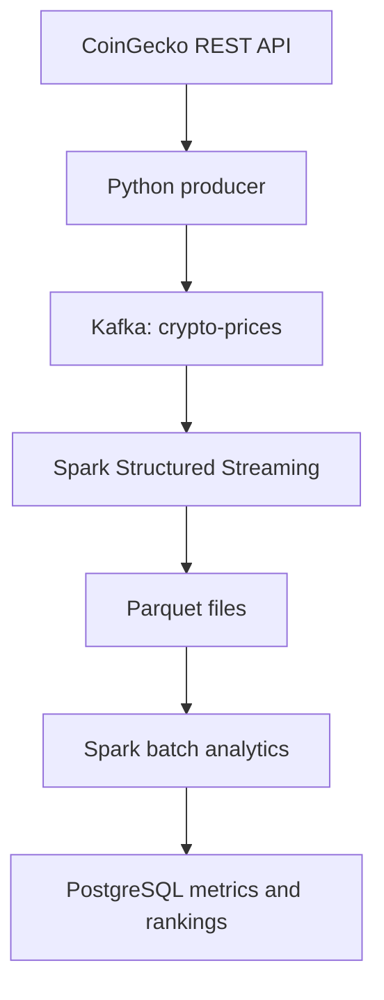

# Marketflow Analysis

A local cryptocurrency data pipeline that polls CoinGecko, publishes market snapshots to Kafka, processes them with Spark Structured Streaming, and stores calculated metrics in PostgreSQL.

## Pipeline



ZooKeeper supports the current Kafka setup. Ingestion is continuous; analytics runs as a separate repeating batch job. This project polls an API rather than consuming an exchange trade feed.

## What it does

- Requests USD market data for up to 20 configured cryptocurrency IDs.
- Publishes one JSON message containing a timestamp and an array of coin records per successful API request.
- Parses and flattens Kafka messages into one row per coin observation.
- Appends Parquet output with a 30-second processing trigger and a persistent streaming checkpoint.
- Calculates price changes, moving averages, price volatility, and five-minute gainers/losers.
- Upserts metrics using a PostgreSQL primary key on `(id, timestamp)` so overlapping runs do not create duplicate keys.

## Stack and files

Python, Requests, kafka-python, Apache Kafka with ZooKeeper, PySpark, Parquet, PostgreSQL, psycopg2, and the PostgreSQL JDBC driver.

| File or directory | Purpose |
| --- | --- |
| Producer script (use its actual filename) | Poll CoinGecko and publish Kafka messages |
| `spark_streaming/kafka_streaming.py` | Read Kafka and write Parquet |
| `spark_streaming/analytics.py` | Calculate metrics and write PostgreSQL tables |
| `dataframes/` | Generated Parquet output and streaming sink metadata |
| `checkpoints/` | Streaming recovery state |

The producer filename and installed Kafka/Spark/Java versions still need to be recorded from the working environment.No Airflow orchestration is claimed here.

## Data contract

The producer calls `https://api.coingecko.com/api/v3/coins/markets` with `vs_currency=usd`. It requests ID, symbol, current price, market capitalization, total volume, 24-hour high/low, and source update time.

Example message shape (illustrative values):

```json
{
  "timestamp": "2026-10-26 11:00:00",
  "data": [{
    "id": "bitcoin",
    "symbol": "btc",
    "current_price": 80000.0,
    "market_cap": 1600000000000,
    "total_volume": 20000000000.0,
    "high_24h": 81000.0,
    "low_24h": 79000.0,
    "last_updated": "2026-10-26T16:00:00Z"
  }]
}
```

The producer sleeps 30 seconds after each request, so observations are typically more than 30 seconds apart. Requested IDs may return fewer than 20 coins. The payload timestamp is the producer machine's local time, not the source's `last_updated` time.

## Metrics

| Metric | Definition |
| --- | --- |
| `change_1min` | Percentage change from the most recent available price at or before 60 seconds earlier |
| `change_5min` | Percentage change from the most recent available price at or before 300 seconds earlier |
| `SMA` | Simple average of the current and previous four observations; fewer observations are used during warm-up |
| `EMA` | Observation-based EMA with span 3 and alpha 0.5; seeded with the first valid price in the loaded history |
| `volatility` | Sample standard deviation of the current and previous four prices, in price units; not return volatility |
| Gainers | Up to five latest coin observations with positive rounded `change_5min`, descending, then ID ascending |
| Losers | Up to five latest coin observations with negative rounded `change_5min`, ascending, then ID ascending |

Changes are rounded to two decimal places before ranking. Missing, zero, and rounded-to-zero changes do not qualify. Rankings may contain fewer than five rows. They currently store rank, ID, and symbol only.

Analytics loads the last 13 minutes, computes metrics, then keeps the last seven minutes for writing. It sleeps six minutes after each run; processing time adds to that interval. Initial startup may not have enough history for five-minute changes.

## Setup

Use the existing working Windows/PowerShell environment. Record its versions before attempting to reproduce it elsewhere:

```powershell
.\env\Scripts\python.exe --version
.\env\Scripts\python.exe -m pip show pyspark kafka-python requests psycopg2-binary
java -version
spark-submit --version
```

Create a virtual environment if needed and install the Python dependencies using a PySpark version compatible with the selected Spark installation. Do not blindly upgrade the working Spark/Java combination. Exact dependency pins are pending environment export.

```powershell
python -m venv env
.\env\Scripts\Activate.ps1
python -m pip install requests kafka-python psycopg2-binary
```

The producer needs outbound HTTPS access to CoinGecko. Kafka listens at `localhost:9092`; PostgreSQL uses `localhost:5432`, database `crypto_metrics`.

Create `crypto_metrics` using pgAdmin, connect its Query Tool, and create the main table if it does not exist:

```sql
CREATE TABLE IF NOT EXISTS public.crypto_table_v2 (
    "timestamp" timestamp without time zone NOT NULL,
    id text NOT NULL,
    symbol text,
    price double precision,
    change_1min double precision,
    change_5min double precision,
    "SMA" double precision,
    "EMA" double precision,
    volatility double precision,
    PRIMARY KEY (id, "timestamp")
);
```

Analytics creates/replaces `top_5_gainers` and `top_5_losers` through JDBC. The current local configuration uses the `postgres` role. The original `crypto_table` is legacy data; new main-metric writes target `crypto_table_v2` explicitly.

Update both Spark scripts' Parquet paths, and the streaming checkpoint path, for your machine. Current code uses absolute Windows file URIs. Preserve a working checkpoint when resuming the same stream.

## Run locally

Open the project root in VS Code. Keep each long-running service in a separate terminal. Start PostgreSQL, then ZooKeeper, Kafka, the producer, Spark streaming, and analytics.

### 1. ZooKeeper and Kafka

Use the startup commands from your installed ZooKeeper-based Kafka distribution. Typical Windows commands, run from that distribution's root in separate terminals, are:

```powershell
.\bin\windows\zookeeper-server-start.bat .\config\zookeeper.properties
```

```powershell
.\bin\windows\kafka-server-start.bat .\config\server.properties
```

These commands apply to distributions containing those files; they are not KRaft setup instructions. If needed, create the topic from the Kafka directory:

```powershell
.\bin\windows\kafka-topics.bat --bootstrap-server localhost:9092 --create --if-not-exists --topic crypto-prices --partitions 1 --replication-factor 1
```

### 2. Producer

Activate the environment and run the producer using its actual relative path:

```powershell
.\env\Scripts\Activate.ps1
python ".\dags\crypto_dags.py"
```

`PATH_TO_PRODUCER.py` is a placeholder. Successful requests print the number of coin records queued for Kafka.

### 3. Spark streaming

Use the existing working `spark-submit` command for `spark_streaming/kafka_streaming.py`. It must include the Spark SQL Kafka connector matching your Spark and Scala versions. The exact connector coordinate is intentionally not guessed here.

If Spark's Windows launcher cannot locate Python, set these in that terminal from the project root:

```powershell
$env:PYSPARK_PYTHON = "$PWD\env\Scripts\python.exe"
$env:PYSPARK_DRIVER_PYTHON = "$PWD\env\Scripts\python.exe"
```

A streaming process normally stays active. Monitor completed batch IDs and Kafka input-message counts; one Kafka message can contain multiple coin rows. Parquet results are written to disk, not printed as a live table.

### 4. Analytics

In its own terminal, set the Python paths above if required. Supply the database password through a hidden prompt:

```powershell
$cryptoSecret = Read-Host "PostgreSQL password" -AsSecureString
$env:CRYPTO_DB_PASSWORD = ([System.Net.NetworkCredential]::new("", $cryptoSecret)).Password
Remove-Variable cryptoSecret
spark-submit --packages org.postgresql:postgresql:42.7.4 ".\spark_streaming\analytics.py"
```

The code must import `os` and use `os.environ["CRYPTO_DB_PASSWORD"]` in `db_properties`. Repeat the prompt in a new terminal. Save edits with Ctrl+S and restart analytics after code or credential changes; a running process does not reload the script.

Success messages include `Main metrics saved to crypto_table_v2.` and `Data written to PostgreSQL (all 3 tables).` The countdown then indicates the next batch run. Use Ctrl+C in the appropriate terminal to stop a process.

## Validation

Run these separately in the `crypto_metrics` Query Tool:

```sql
SELECT "timestamp", id, price, change_1min, change_5min, "SMA", "EMA"
FROM public.crypto_table_v2
WHERE id = 'bitcoin'
ORDER BY "timestamp" DESC
LIMIT 15;
```

```sql
SELECT id, "timestamp", COUNT(*) AS copies
FROM public.crypto_table_v2
GROUP BY id, "timestamp"
HAVING COUNT(*) > 1;
```

```sql
SELECT * FROM top_5_gainers ORDER BY rank;
SELECT * FROM top_5_losers ORDER BY rank;
```

The duplicate check should return zero rows. For consecutive observations from the same analytics calculation, verify `EMA_current = 0.5 * price_current + 0.5 * EMA_previous`, allowing floating-point tolerance.

Manual checks completed during development: advancing streaming batches, successful writes to all three tables, no duplicate keys in the new metrics table, and sample SMA/EMA arithmetic. These are local observations, not an automated test suite or a production reliability guarantee.

## Limitations and next improvements

- Producer `send()` is asynchronous: its print message means queued, not confirmed delivery. Delivery acknowledgments and retries need explicit handling.
- HTTP errors are printed, but request exceptions currently stop the producer. Add retry/backoff and response validation.
- Polling can retrieve unchanged source prices. Requested IDs should be checked against current API responses.
- Local timestamps lack timezone information. Normalize event times to UTC and retain source timestamps for freshness checks.
- Lookbacks have no maximum staleness bound; gaps can make reference prices older than the nominal interval.
- The EMA is re-seeded from each run's 13-minute input. It is a finite-history approximation to a persistent full-history EMA.
- The 13-minute lookback covers normal overlapping runs, but long outages can leave historical gaps. Add explicit backfill and data-quality checks.
- Metrics are upserted row by row from Spark to the driver, appropriate for this small local dataset. Scale with staged batch writes and a database merge.
- Main metrics and the two ranking tables are separate transactions. Ranking overwrite can replace tables and their metadata; publication is not atomic across all three tables.
- Old rows in `crypto_table` retain legacy calculations; they are not automatically repaired or migrated.
- Absolute paths, repeated Parquet scans, and many small files need improvement for larger deployments.

## Before publishing

Keep passwords, API keys, virtual environments, generated Parquet files, and checkpoints out of source control. Suggested `.gitignore` entries:

```gitignore
env/
.venv/
__pycache__/
*.pyc
.env
.env.*
!.env.example
dataframes/
checkpoints/
spark-warehouse/
```

Ignoring a file does not remove previously committed content. Review Git history for secrets and rotate any exposed credentials. Add the actual producer filename, exact working startup commands, version pins, and a fresh-clone run check before presenting this as fully reproducible.
