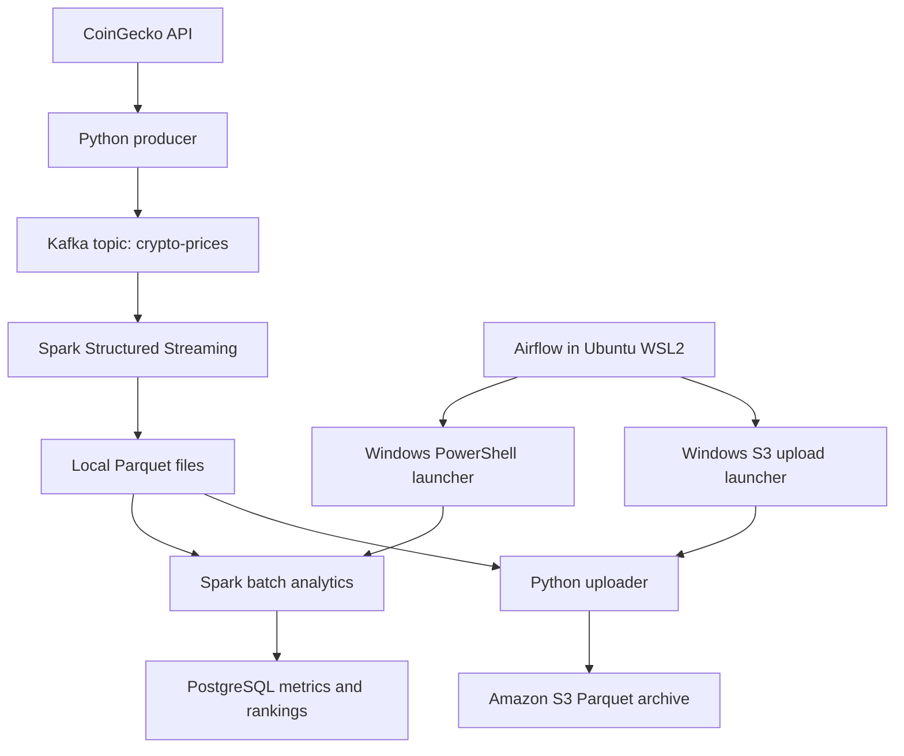

# Marketflow Analysis

A cryptocurrency data pipeline using Python, Kafka, Spark, PostgreSQL, Apache Airflow, and Amazon S3. Processing runs locally on Windows/WSL2; S3 stores an archive of completed Parquet files. It polls CoinGecko, streams market snapshots into Parquet, calculates market metrics, and publishes metrics and rankings to PostgreSQL. Airflow schedules analytics followed by the S3 archival task every six minutes, while the local services and a valid AWS login session are available.

## Architecture



ZooKeeper supports the current Kafka installation. The producer and streaming consumer run continuously and start manually. Airflow runs `run_spark_analytics` followed by `upload_parquet_to_s3`; it does not start Kafka or manage the ingestion services. This pipeline polls an API rather than consuming an exchange trade feed.

## Features

- Poll USD market data for up to 20 configured cryptocurrency IDs.

- Publish a timestamped JSON snapshot to Kafka after each successful API request.

- Flatten each snapshot into coin observations and append Parquet output with streaming checkpoints.

- Calculate one-minute and five-minute price changes, SMA, EMA, and price volatility.

- Rank up to five gainers and five losers using each coin's newest observation.

- Upsert main metrics on `(id, timestamp)` to avoid duplicate keys across overlapping runs.

- Schedule analytics every six minutes with Airflow, one retry after two minutes, and at most one active DAG run.

- Archive committed Parquet files to a private S3 bucket using Boto3.
- Skip existing S3 keys when their stored size matches the local file.
- Preview the completed file count and size before uploading.
- Expose task status and execution logs in the Airflow dashboard.

- Load a Windows-encrypted PostgreSQL credential from outside the repository.

## Project files

| File or directory | Purpose |

| --- | --- |

| `dags/crypto_dags.py` | CoinGecko producer; despite its directory/name, this is a long-running script, not an Airflow DAG |

| `dags/marketflow_analytics_dags.py` | Airflow DAG: analytics followed by S3 archival |

| `spark_streaming/kafka_streaming.py` | Kafka consumer that writes Parquet |

| `spark_streaming/analytics.py` | One analytics run, PostgreSQL writes, then exit |

| `Scripts/run_analytics.ps1` | Windows launcher that configures Java/Python and loads the saved credential |

| `Scripts/upload_to_s3.py` | Reads committed Spark output metadata, previews files, and uploads Parquet to S3 |
| `Scripts/run_s3_upload.ps1` | Runs the Windows Python uploader and propagates its exit code |
| `requirements.txt` | Windows pipeline Python dependencies |

| `dataframes/` | Generated Parquet output and sink metadata; excluded from Git |

| `checkpoints/` | Streaming recovery state; excluded from Git |

Windows accepts `scripts` and `Scripts` interchangeably in paths. Use the actual `Scripts` folder casing when browsing the repository or accessing files through Linux.

## Data contract

The producer requests `https://api.coingecko.com/api/v3/coins/markets` with `vs_currency=usd`. A Kafka message contains a producer-local timestamp and an array of coin records:

```json
{
  "timestamp": "2026-10-28 13:00:00",
  "data": [
    {
      "id": "bitcoin",
      "symbol": "btc",
      "current_price": 80000.0,
      "market_cap": 1600000000000,
      "total_volume": 20000000000.0,
      "high_24h": 81000.0,
      "low_24h": 79000.0,
      "last_updated": "2026-10-28T18:00:00Z"
    }
  ]
}
```

Values above are illustrative. The producer sleeps 30 seconds after each request, so observations are usually more than 30 seconds apart. API responses can include fewer than 20 configured coins. The payload timestamp is local machine time, not the source's `last_updated` time.

## Metrics and tables

| Output | Definition |

| --- | --- |

| `change_1min` | Percentage change from the latest available price at or before 60 seconds earlier |

| `change_5min` | Percentage change from the latest available price at or before 300 seconds earlier |

| `SMA` | Mean of the current and previous four observations; fewer during warm-up |

| `EMA` | Span-three, observation-based EMA with alpha 0.5, seeded from the first valid price in the loaded history |

| `volatility` | Sample standard deviation of the current and previous four prices, in price units |

| Gainers | Latest coin observations with positive rounded five-minute change, sorted descending, then ID ascending |

| Losers | Latest coin observations with negative rounded five-minute change, sorted ascending, then ID ascending |

Changes are rounded to two decimal places before ranking. Null and rounded-to-zero changes do not qualify. Rankings may contain fewer than five rows and store rank, ID, and symbol.

Analytics loads 13 minutes of input history, calculates metrics, then retains seven minutes of output. Airflow replaces the former in-script countdown; the script now runs once and exits. A guard raises an error if the seven-minute output is empty after calculation. The earlier branch for no input in the initial 13-minute window currently prints a message and exits successfully without writes.

| PostgreSQL table | Write behavior |

| --- | --- |

| `public.crypto_table_v2` | Upsert on `(id, timestamp)` |

| `top_5_gainers` | JDBC overwrite per completed analytics run |

| `top_5_losers` | JDBC overwrite per completed analytics run |

The original `crypto_table` is legacy data. Current main-metric writes target `crypto_table_v2`.

## Environment and prerequisites

This is a local Windows/WSL2 development setup:

- Windows pipeline virtual environment: Python 3.11.9 and PySpark 3.5.9.

- PostgreSQL on Windows: `localhost:5432`, database `crypto_metrics`, role `postgres`.

- Kafka on Windows: `localhost:9092`, topic `crypto-prices`, with ZooKeeper.

- Analytics PostgreSQL JDBC package: `org.postgresql:postgresql:42.7.4`.

- Launcher Java path in the tested setup: `C:\Program Files\Microsoft\jdk-21.0.12.101-hotspot`.

- Airflow 3.3.2 in Ubuntu under WSL2, using Python 3.14.4 and a separate `~/airflow-venv` environment.

- Airflow standalone for local learning/development; Docker Desktop is not required by this configuration.

These versions describe the tested local environment, not a guarantee of compatibility on every machine. The installed Kafka/Scala versions and exact streaming connector command still need recording. Spark/Java compatibility should be verified before reproducing this setup; do not blindly upgrade the working environment.

The laptop used during development reported about 3.4 GB usable RAM. Resource contention and an earlier API connection failure were observed; the cause of that failure was not established. Scheduled runs later completed successfully. Close unused applications when running the full stack.

### Windows Python setup

From the project root, if creating a new environment:

```powershell
python -m venv env
.\env\Scripts\Activate.ps1
python -m pip install -r requirements.txt
```

Kafka, Java, PostgreSQL, and the Spark Kafka connector require separate setup. Airflow belongs in its Ubuntu environment, not the Windows pipeline environment.

Update absolute Parquet/checkpoint paths in the Spark scripts and Windows/WSL paths in the DAG for your machine. The committed launcher also contains a machine-specific Java path. Preserve checkpoints when resuming the same stream.

### PostgreSQL schema

Create `crypto_metrics` in pgAdmin, connect the Query Tool to it, then run:

```sql
CREATE TABLE IF NOT EXISTS public.crypto_table_v2 (
    "timestamp" timestamp without time zone NOT NULL,
    id text NOT NULL,
    symbol text,
    price double precision,
    change_1min double precision,
    change_5min double precision,
    "SMA" double precision,
    "EMA" double precision,
    volatility double precision,
    PRIMARY KEY (id, "timestamp")
);
```

The analytics job creates/replaces the ranking tables through JDBC.

### Save the database credential once

Run these commands in **Windows PowerShell**, one at a time. Enter the PostgreSQL password only at the hidden prompt:

```powershell
New-Item -ItemType Directory -Force -Path "$env:LOCALAPPDATA\Marketflow" | Out-Null
$cryptoSecret = Read-Host "PostgreSQL password" -AsSecureString
$databaseCredential = [System.Management.Automation.PSCredential]::new("postgres", $cryptoSecret)
$databaseCredential | Export-Clixml "$env:LOCALAPPDATA\Marketflow\postgres.xml"
Remove-Variable databaseCredential, cryptoSecret
```

On Windows, the saved credential is encrypted for the same Windows account and computer. The launcher imports it, supplies the password through `CRYPTO_DB_PASSWORD` to the Spark process, and propagates Spark's exit code. The file stays outside the repository. Repeat credential setup after a password change or when moving to another account/computer.

### Airflow setup in Ubuntu

Enter Ubuntu from PowerShell with `wsl -d Ubuntu`. For a fresh Ubuntu setup:

```bash
sudo apt update
sudo apt install -y python3-venv python3-pip
python3 -m venv ~/airflow-venv
source ~/airflow-venv/bin/activate
python -m pip install "apache-airflow==3.3.2" --constraint "https://raw.githubusercontent.com/apache/airflow/constraints-3.3.2/constraints-3.14.txt"
```

The constraints above match Python 3.14. Use constraints matching your Python version if it differs.

Install only the actual Airflow DAG into Airflow's DAG directory. From the project root in Ubuntu:

```bash
mkdir -p ~/airflow/dags
cp dags/marketflow_analytics_dags.py ~/airflow/dags/
```

Do not copy or point Airflow at the whole project `dags` folder: `crypto_dags.py` runs the continuous producer at module level. After editing the Airflow DAG, copy the updated file again.

## Amazon S3 setup and archival

The configured destination is `s3://marketflow-analysis-donnie-2026/parquet/` in `us-east-2` (Ohio). The bucket has public access blocked, ACLs disabled, and SSE-S3 encryption. S3 stores copies of completed local Parquet files; analytics continues to read the local dataset and write PostgreSQL. Compute has not been moved to AWS.

### Install and sign in — Windows PowerShell

Install AWS CLI v2 from the [official Windows installation guide](https://docs.aws.amazon.com/cli/latest/userguide/getting-started-install.html). Open a fresh terminal after installation. From the project root:

```powershell
aws --version
.\env\Scripts\python.exe -m pip install "boto3[crt]>=1.41.0"
aws login --profile marketflow
```

Choose `us-east-2` when prompted and complete browser authorization. The uploader explicitly uses the `marketflow` profile. Keep login tokens and AWS configuration outside Git; no access keys are embedded in the scripts. Another account must create its own bucket and update `BUCKET`, `PREFIX`, and session settings in `Scripts/upload_to_s3.py`.

AWS CLI browser-login support requires a recent CLI; Boto3 login-profile support requires Boto3 1.41.0 or later with the CRT dependency. See [Boto3 credential documentation](https://docs.aws.amazon.com/boto3/latest/guide/credentials.html) and [AWS CLI sign-in documentation](https://docs.aws.amazon.com/cli/latest/userguide/cli-configure-sign-in.html).

**Authentication is temporary.** The browser-login session lasts at most 12 hours. If the uploader reports `LoginRefreshRequired`, run `aws login --profile marketflow` again in Windows PowerShell. Airflow cannot perform browser authorization unattended. This setup demonstrates scheduled local archival during a valid session, not permanent unattended cloud operation.

Add this dependency to `requirements.txt`:

```text
boto3[crt]>=1.41.0
```

### Preview and upload — Windows PowerShell

Run from the project root:

```powershell
.\env\Scripts\python.exe .\Scripts\upload_to_s3.py
```

The default mode prints the count, size, and destination without uploading. To upload:

```powershell
powershell.exe -NoProfile -NonInteractive -ExecutionPolicy Bypass -File .\Scripts\run_s3_upload.ps1
```

The Python script reads the newest compact Spark sink log, when present, plus later batch logs under `dataframes/_spark_metadata`. It selects referenced Parquet files with `action: add`, checks local sizes against metadata, and preserves their relative paths under `parquet/`. It does not upload checkpoints or Spark sink metadata. Preserve the local output and checkpoint directories when resuming the stream.

Existing objects are checked with `HeadObject`. Matching key and size means skip; a size mismatch raises an error. This is a size-based repeat-upload check, not a content-hash comparison. The script does not delete local or remote files, compact small files, or create a restorable Spark checkpoint backup. Retrying an interrupted upload run checks existing objects again.

### Airflow integration

The DAG runs `run_spark_analytics >> upload_parquet_to_s3`. Both tasks allow one retry after two minutes. The upload task has a ten-minute execution timeout. `max_active_runs=1` prevents overlapping runs of this DAG; do not run another uploader manually during the scheduled upload.

Airflow invokes `Scripts/run_s3_upload.ps1` through Windows PowerShell. Boto3 and AWS login credentials belong to the Windows account executing that process; they are not installed or configured separately inside Ubuntu for this arrangement. After editing the DAG, copy only `dags/marketflow_analytics_dags.py` into `~/airflow/dags/`.

AWS storage and requests consume the account's available allowance or credits. Monitor usage and keep the bucket private. This project does not require a paid-plan upgrade or additional AWS compute services.

## Start the pipeline

Keep each long-running service in a separate terminal. PostgreSQL must be running.

### 1. ZooKeeper and Kafka — Windows

From your ZooKeeper-based Kafka distribution directory, in separate PowerShell terminals:

```powershell
.\bin\windows\zookeeper-server-start.bat .\config\zookeeper.properties
```

```powershell
.\bin\windows\kafka-server-start.bat .\config\server.properties
```

These apply only to distributions containing those files, not KRaft installations. If needed:

```powershell
.\bin\windows\kafka-topics.bat --bootstrap-server localhost:9092 --create --if-not-exists --topic crypto-prices --partitions 1 --replication-factor 1
```

### 2. Producer — Windows

From the project root:

```powershell
.\env\Scripts\python.exe .\dags\crypto_dags.py
```

Successful requests print the number of coin records queued for Kafka.

### 3. Streaming consumer — Windows

Use the existing working `spark-submit` command for `spark_streaming/kafka_streaming.py`, including the Kafka connector matching your installed Spark and Scala versions. That exact connector coordinate has not yet been documented here.

Set Python paths in that terminal if required:

```powershell
$env:PYSPARK_PYTHON = "$PWD\env\Scripts\python.exe"
$env:PYSPARK_DRIVER_PYTHON = "$PWD\env\Scripts\python.exe"
```

The streaming process stays active and writes Parquet. Allow at least six minutes of fresh observations for a five-minute comparison; source cadence and gaps can require longer.

### 4. Airflow — Ubuntu

```bash
source ~/airflow-venv/bin/activate
airflow standalone
```

Leave this terminal running and open `http://localhost:8080` in the Windows browser. Use the Airflow-generated credentials, not the Ubuntu or PostgreSQL password. If needed, retrieve them privately in another Ubuntu terminal:

```bash
cat ~/airflow/simple_auth_manager_passwords.json.generated
```

Search for `marketflow_analytics` in the dashboard. The DAG is paused on first creation. Trigger one manual run, inspect `run_spark_analytics` logs and confirm database writes, then inspect `upload_parquet_to_s3` logs and its uploaded/skipped counts. Then unpause it to enable the six-minute schedule. Verify a run with **Run Type: Scheduled** and **State: Success**.

Airflow launches Windows PowerShell through WSL interoperability. The PowerShell script then runs Windows Spark against Windows paths and localhost PostgreSQL. Spark and psycopg2 do not need to be installed inside Airflow's Python environment for this arrangement.

The Windows VS Code interpreter may underline Airflow imports because Airflow is installed in Ubuntu. Run/import the DAG in the Ubuntu Airflow environment; the VS Code Windows “Run Python File” button is not how this DAG is executed.

### Optional: run analytics manually — Windows

From the project root:

```powershell
powershell.exe -NoProfile -NonInteractive -ExecutionPolicy Bypass -File .\Scripts\run_analytics.ps1
$LASTEXITCODE
```

Do not launch manual analytics concurrently with the scheduled job. Expected log messages are `Main metrics saved to crypto_table_v2.` and `Data written to PostgreSQL (all 3 tables).`; also verify nonempty results and fresh database timestamps. Exit code zero alone does not prove records were processed.

## Stop and restart

1. Pause `marketflow_analytics` in the Airflow dashboard to prevent new scheduled runs.

2. Let any active DAG run, including S3 upload, finish.

3. Stop Airflow, the producer, and streaming consumer with Ctrl+C in their respective terminals.

4. Stop Kafka, then ZooKeeper. Answer `Y` if Windows asks to terminate the batch job.

Pausing does not cancel an active run. After a computer restart, start the services again, collect fresh data, refresh the Windows AWS login if needed, start Airflow, and unpause the DAG when ready. Scheduling only runs while Airflow and the required local services are running; this is not an always-on deployment.

## Validation

In the `crypto_metrics` Query Tool:

```sql
SELECT "timestamp", id, price, change_1min, change_5min, "SMA", "EMA"
FROM public.crypto_table_v2
WHERE id = 'bitcoin'
ORDER BY "timestamp" DESC
LIMIT 15;
```

```sql
SELECT id, "timestamp", COUNT(*) AS copies
FROM public.crypto_table_v2
GROUP BY id, "timestamp"
HAVING COUNT(*) > 1;
```

```sql
SELECT * FROM public.top_5_gainers ORDER BY rank;
SELECT * FROM public.top_5_losers ORDER BY rank;
```

The duplicate check should return zero rows. Within one calculation's consecutive observations, check `EMA_current = 0.5 * price_current + 0.5 * EMA_previous`, allowing floating-point tolerance.

Development checks completed locally:

- Advancing streaming batches and successful writes to the three PostgreSQL tables.

- Duplicate-key query and sample SMA/EMA arithmetic checks.

- One-shot analytics launcher and loading the encrypted credential without a terminal-provided password.

- Ubuntu-to-Windows launcher execution with exit code zero.

- Successful Airflow manual execution with database-write logs.

- Two successful scheduled analytics runs observed in the dashboard before the S3 addition.
- AWS CLI upload/download connection test and successful Python S3 connection check.
- Initial manual archival: 694 Parquet files totaling approximately 2.59 MB uploaded.
- Repeat archival: zero uploaded and all 694 skipped as already present.
- Airflow S3 task completed successfully with zero uploads, 694 skips, and exit code zero.

Still to verify: an Airflow run uploads newly generated files, and a downloaded Parquet object matches its local file by SHA-256. The successful skip-only run proves orchestration and remote existence/size checks, not new-file transfer through Airflow.

These are manual development checks, not an automated test suite or a production reliability guarantee.

## Known limitations and next improvements

- The API producer uses asynchronous Kafka `send()`: its message means queued, not confirmed delivery. Add acknowledgment handling, request retries/backoff, and response validation.

- Source prices can remain unchanged across polls. Check requested coin IDs against API responses.

- Timestamps are timezone-naive local times. Normalize to UTC and retain source freshness timestamps.

- Lookbacks have no maximum staleness bound. Gaps can select older reference prices than the nominal interval.

- EMA is re-seeded from each run's 13-minute history, approximating a persistent full-history EMA.

- Long outages are not backfilled. A no-input 13-minute branch still exits successfully; improve explicit no-data status handling.

- Main metric upserts and ranking overwrites are separate transactions. Ranking overwrites can replace metadata; publication across all tables is not atomic.

- Row-by-row driver-side upserts suit this small dataset; larger deployments need staged/batched database writes.

- Absolute paths, small Parquet files, and repeated scans limit portability and scalability.

- Spark logs a Windows temporary JDBC JAR deletion error during shutdown. Observed runs still completed writes and returned exit code zero. Investigate cleanup and Spark/Java compatibility rather than treating every shutdown stack trace as an analytics failure.

- Airflow standalone and this WSL-to-Windows launcher are for local development. Ingestion startup remains manual. S3 archival is implemented; cloud compute deployment and Databricks are not implemented.
- S3 archival depends on a valid Windows AWS browser-login session and requires periodic manual reauthentication. It scans committed metadata and performs one remote existence check per file, which becomes inefficient as the archive grows.
- Concurrent Spark metadata compaction can remove a log while the uploader reads it; an affected run may fail and require retry. Local files must remain available.
- S3 repeat-upload checks compare size rather than content hashes; no full restore or automated integrity test has been completed.

## Source control

Keep credentials, generated datasets, checkpoints, virtual environments, and runtime logs out of Git. Relevant ignore entries:

```gitignore
env/
.venv/
__pycache__/
*.pyc
.env
.env.*
!.env.example
dataframes/
checkpoints/
spark-warehouse/
```

Airflow's runtime state lives under Ubuntu `~/airflow`; only the DAG source belongs in this repository. The encrypted credential lives under Windows `%LOCALAPPDATA%\Marketflow`, outside the repository. Ignoring a file does not remove it from existing Git history.

Reproducibility work remaining: record the exact Kafka/Scala versions and streaming connector command, remove machine-specific paths, and validate setup from a fresh clone.
